# Exploratory data analysis (exploration set)

3,178,679 cleaned filings (FY2017–2022). The confirmation set was not used. **Relative PW** = log prevailing wage minus the median of the same SOC title × worksite state × fiscal year (cells with ≥ 5 wages); a value of +0.05 is about 5% above comparable jobs.

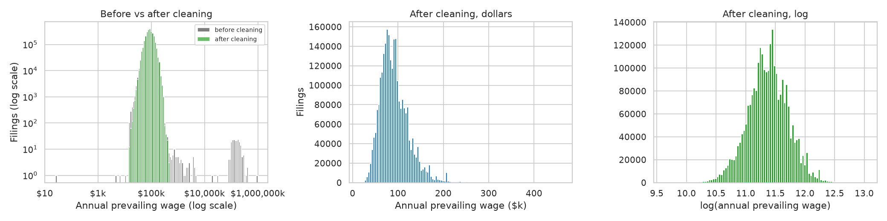

**Cleaning removes the impossible tails, and log wage is almost exactly symmetric.** Before cleaning, wage × stated unit runs from $25.58 to $1,000,000,000 a year (unit errors and outliers, left). After cleaning, annual PW has skew 1.14 (median $88k, mean $92k); log PW has skew -0.04. After cleaning, the range is $15k (exactly $7.25 × 2,080 h, the federal minimum wage) to $462k (physicians). Means, t-tests and linear models on log PW are reasonable.

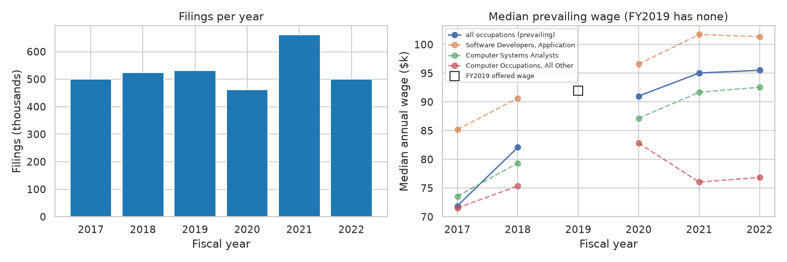

**Filings and wages both rose over the period, and FY2019 can't be compared on prevailing wage.** The median PW grew 32.8% from FY2017 ($72k) to FY2022 ($96k); FY2021 had the most filings (661,044 in this set). FY2019 has only the offered wage (median $92k), which isn't the same quantity, so it's shown separately. Any wage comparison has to hold the year fixed.

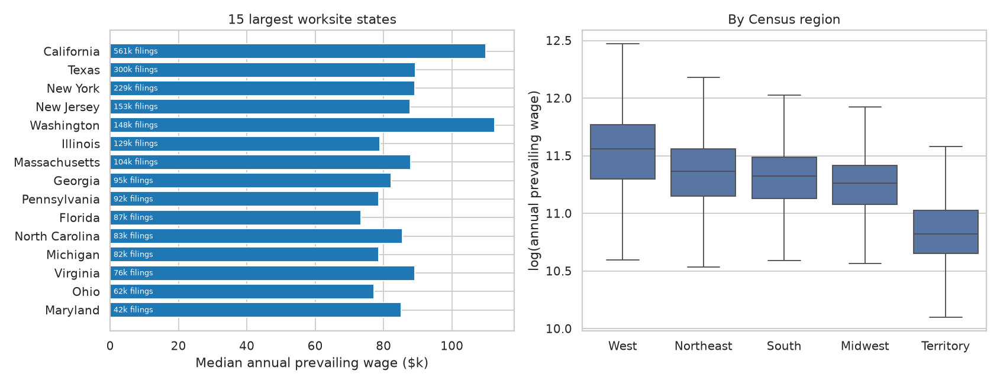

**Location shifts the wage a lot, so comparisons must be within state.** The 15 largest worksite states hold 83% of filings, led by California, Texas, New York. Median PW is highest in the West ($105k) and lowest in the Midwest ($78k) and the South ($83k). West vs Midwest is a 35% gap, about as large as the whole FY2017–22 wage growth. (Territories are lower, $50k, but small.)

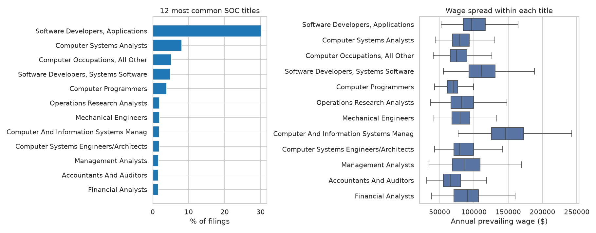

**This is mostly a computer-jobs dataset.** 1,123 SOC titles appear, but 'Software Developers, Applications' alone is 30.2% of filings, the top 5 are 52.2%, and computer and software titles together are 64.5%. Within a title, the 75th percentile wage is typically 1.39× the 25th (wage level and metro area), so occupation has to be fixed before comparing anything else.

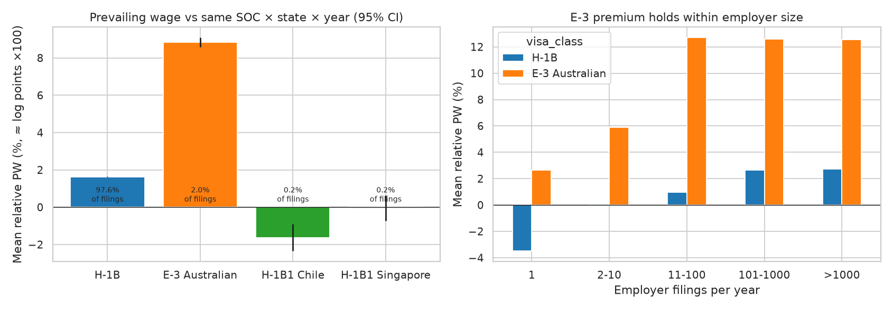

**E-3 (Australian) filings carry a higher prevailing wage than H-1B filings for the same job, place and year.** Relative to the median for their SOC × state × year, E-3 filings are +8.8% on average (median +7.1%), H-1B +1.6%. This is not explained by employer size: in every size group above 10 filings a year, E-3 is about +13% against +1 to +3% for H-1B. Since PW is set by DOL from occupation, area and wage level, the likely source is that employers file Australians at higher wage levels. **Candidate problem statement.**

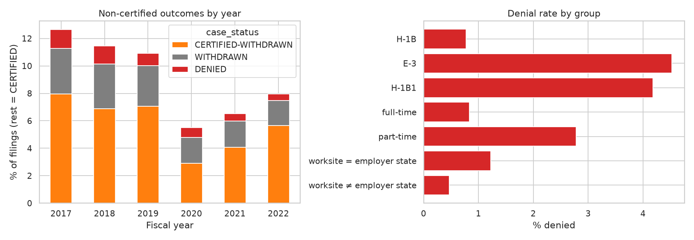

**Denials are rare and falling, and they are concentrated in a few groups.** Overall 0.87% of filings are denied; the rate fell from 1.36% in FY2017 to 0.49% in FY2022. CERTIFIED-WITHDRAWN dropped sharply in FY2020 (7.1% → 2.9%). E-3 filings are denied 5.8× as often as H-1B (4.53% vs 0.78%), part-time 3.3× as often as full-time, and filings for the employer's own state 2.6× as often as out-of-state ones.

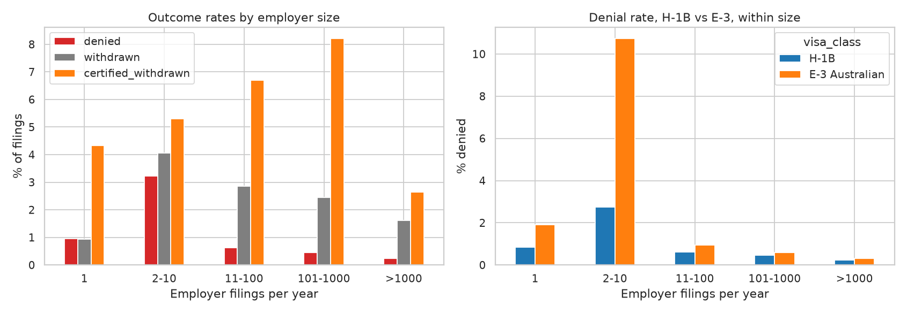

**Denial rates peak at small repeat filers, and part of the E-3 denial gap is employer mix.** Employers with 2–10 filings a year have a 3.2% denial rate, against 0.9% for one-time filers and 0.23% for the largest. Among 2–10-filing employer-years with any denial, 44% of their filings are denied, which looks like the same application refiled after a denial. 52% of E-3 filings come from employers with ≤10 filings, against 18% of H-1B; but even within size groups E-3 is denied more (2–10 filings: 10.7% vs 2.8%). **Candidate problem statement.**

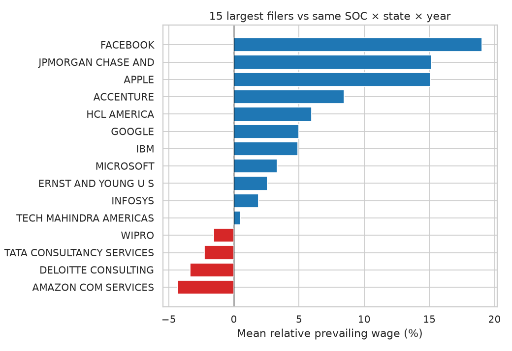

**Big filers don't all file low.** The 15 largest employers (19% of filings) range from -4.3% to +19.0% against comparable jobs: AMAZON COM SERVICES, DELOITTE CONSULTING, TATA CONSULTANCY SERVICES, WIPRO file below the cell median, while FACEBOOK (+19.0%) and JPMORGAN CHASE AND (+15.1%) file above it. The common belief that outsourcing firms file at the lowest levels isn't a clean split here.

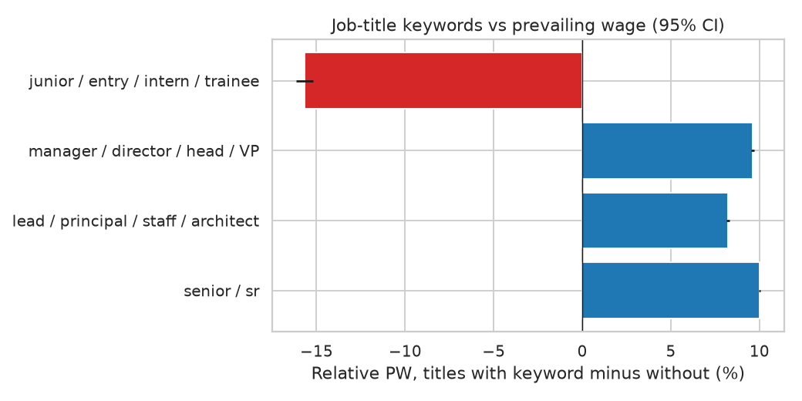

**Job-title keywords behave as expected, which supports relative PW as a wage-level proxy.** 'Senior' titles (15% of filings) sit +10.0% above other titles in the same SOC × state × year, manager/director titles +9.6%, and junior/entry/intern titles -15.7% (only 8,020 filings).

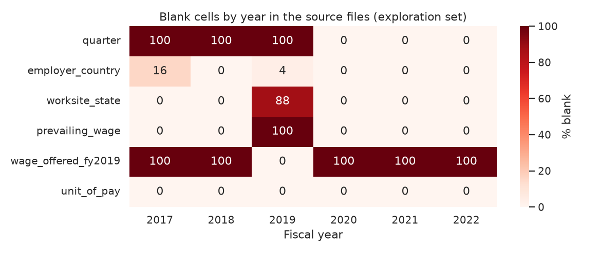

**Missingness is structural, by year, not random.** Quarter is blank before FY2020 (column absent); FY2019 has no prevailing wage (100% blank) and no worksite in 88% of rows; employer country is blank in 16% of FY2017 rows (filled during cleaning). Every analysis has to state which years it can use.

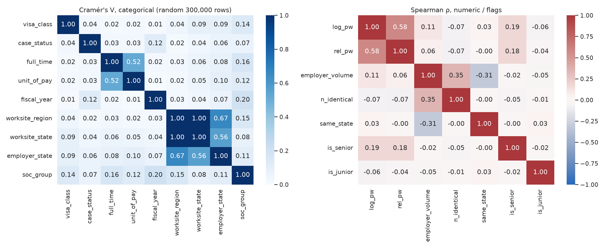

**Most categorical features are only weakly related; the strong links are geography and pay unit.** Cramér's V: worksite state ~ region 1.00 (nested), worksite ~ employer state 0.56, full-time ~ unit of pay 0.52 (part-time jobs are paid by the hour); everything else is ≤ 0.20. Visa class is nearly unrelated to everything else (V ≤ 0.14), so a visa comparison isn't confounded by one dominant variable. Numerically, log employer volume and log n_identical are ρ = 0.35, so they shouldn't both enter one model unregularized, and bigger filers send workers out of their own state more often (volume ~ same_state ρ = -0.31): consulting placements.

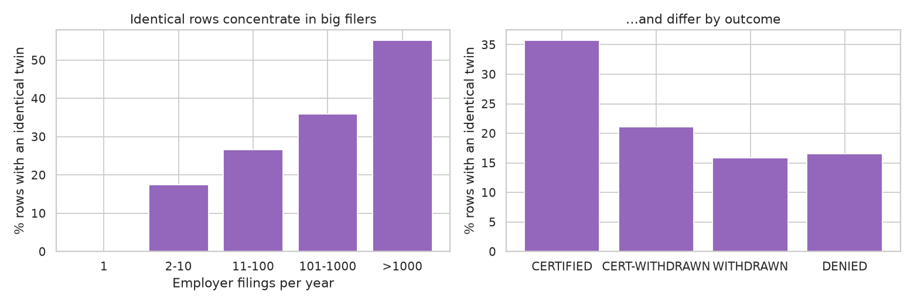

**Identical rows look like real separate filings, which supports keeping them (cleaning step 1).** 34% of rows have an identical twin; the share rises from 18% at employers with 2–10 filings to 55% at the largest, and it is 36% for CERTIFIED against 16% for WITHDRAWN. A copying error wouldn't depend on employer size or outcome. Because one employer's filings are so similar, tests must cluster by employer.

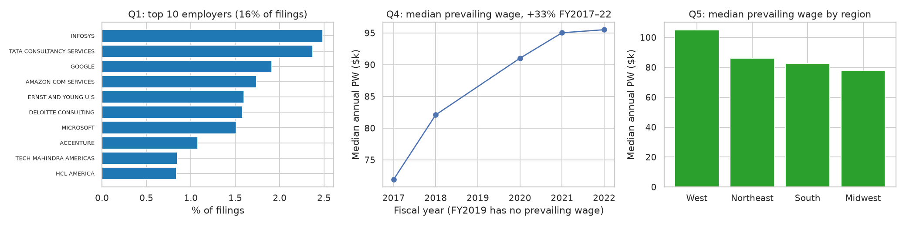

**Basic questions 1, 4 and 5.** The 10 largest employers file 16% of all filings (INFOSYS, TATA CONSULTANCY SERVICES, GOOGLE, AMAZON COM SERVICES, ERNST AND YOUNG U S lead); the median prevailing wage rose 32.8% from FY2017 to FY2022; the West pays the most and the Midwest the least.

## What this means for the next steps

- Work on **log prevailing wage**, always **within SOC title × state × year**; raw comparisons mix occupation, place and time.
- Use FY2017–18 and FY2020–22 for prevailing-wage questions; FY2019 only for status questions.
- The two non-obvious patterns worth testing involve **visa class**: the E-3 wage premium (Fig. 5) and the E-3 denial gap that remains after employer size (Fig. 7).
- Filings from one employer are near-copies (Fig. 12): **inference must use employer-clustered SEs**.
