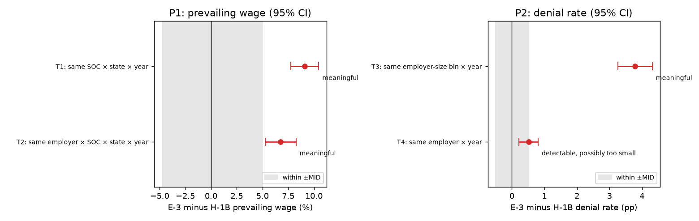
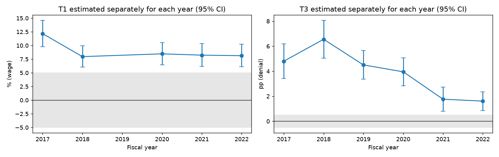

# Hypothesis test results (confirmation set)

Pre-registered in `report/preregistration.md`; each test run once. Confirmation set cleaned with the exploration-fitted rules (`report/cleaning_log_confirm.md`): 794,670 filings, no rows removed. Family-wise α = 0.05 (Holm, 4 tests), two-sided, employer-clustered SEs with t(G − 1) reference. Wild-cluster bootstrap: restricted, Rademacher, 1,999 draws.

| test   | comparison                                                      | rows / E-3 rows   |   employers (G) | estimate   | 95% CI                 | t (df)         |        p |   p Holm | p wild bootstrap   | Holm decision   |   p TOST | MID      | verdict                        |
|:-------|:----------------------------------------------------------------|:------------------|----------------:|:-----------|:-----------------------|:---------------|---------:|---------:|:-------------------|:----------------|---------:|:---------|:-------------------------------|
| T1     | E-3 vs H-1B prevailing wage, same SOC × state × year            | 408,671 / 10,433  |          19,299 | +9.09%     | [+7.74%, +10.46%]      | 13.66 (19,298) | 2.95e-42 | 8.85e-42 | ≤ 1/2000           | reject H₀       |     1    | 5.00%    | meaningful                     |
| T2     | E-3 vs H-1B prevailing wage, same employer × SOC × state × year | 71,060 / 3,356    |             695 | +6.76%     | [+5.29%, +8.26%]       | 9.24 (694)     | 2.91e-19 | 5.82e-19 | ≤ 1/2000           | reject H₀       |     0.99 | 5.00%    | meaningful                     |
| T3     | E-3 vs H-1B denial rate, same employer-size bin × year          | 791,227 / 14,587  |          32,956 | +3.789 pp  | [+3.263 pp, +4.315 pp] | 14.12 (32,955) | 4.02e-45 | 1.61e-44 | ≤ 1/2000           | reject H₀       |     1    | 0.500 pp | meaningful                     |
| T4     | E-3 vs H-1B denial rate, same employer × year                   | 382,911 / 8,003   |           1,547 | +0.515 pp  | [+0.222 pp, +0.808 pp] | 3.44 (1,546)   | 0.000592 | 0.000592 | ≤ 1/2000           | reject H₀       |     0.54 | 0.500 pp | detectable, possibly too small |

## Raw vs adjusted gaps

| test   | E-3 mean             | H-1B mean   | raw gap (no fixed effects)   | adjusted gap (test)   |
|:-------|:---------------------|:------------|:-----------------------------|:----------------------|
| T1     | 93,490 (geo. mean $) | 85,314      | +9.58%                       | +9.09%                |
| T2     | 93,490 (geo. mean $) | 85,314      | +9.58%                       | +6.76%                |
| T3     | 5.32%                | 0.77%       | +4.547 pp                    | +3.789 pp             |
| T4     | 5.32%                | 0.77%       | +4.547 pp                    | +0.515 pp             |

## Interpretation

**P1: E-3 filings carry a meaningfully higher prevailing wage, and most of it is within employer.**
- T1: for the same SOC title, state and year, E-3 filings are +9.1% [+7.7, +10.5] above H-1B; the whole CI is above the 5% MID. The raw gap is +9.6%, so occupation, state and year mix explain almost none of it.
- T2: within the same employer, job, state and year the gap is +6.8% [+5.3, +8.3], still entirely above the MID. About 75% of the T1 gap (in log points) remains when the employer is held fixed (T2 uses only employers filing both visas for the same job, so this compares two populations rather than splitting one gap exactly), so it isn't mainly that higher-paying employers hire Australians: the same employer files its E-3 workers at a higher wage level.
- Stable across years (+8.0% to +12.2%, Fig. 14), unchanged without the largest employer, and the wild-cluster bootstrap agrees (p ≤ 1/2000).
- Clustering matters: treating filings as independent gives an SE of 0.0027, against 0.0064 clustered by employer (2.4× larger).

**P2: E-3 filings are denied more often, but within employer the gap is small in absolute terms.**
- T3: holding employer size and year fixed, E-3 filings are denied +3.79 pp [+3.26, +4.31] more often (H-1B rate 0.77%). The raw gap is +4.55 pp, so employer size explains only 17% of it. The power check expected only 0.16 power at the 0.5 pp MID, but the effect is far larger than the MID, so that doesn't limit this result. Logit odds ratio 3.8.
- The T3 gap shrinks over time, from +6.6 pp in FY2018 to +1.6 pp in FY2022 (Fig. 14), in line with the overall fall in denials.
- T4: within the same employer and year the gap is +0.51 pp [+0.22, +0.81], which rejects H₀ but the CI straddles the 0.5 pp MID, so it may be too small to matter. In relative terms it isn't small: these employers' H-1B rate is 0.30%, so E-3 is about 2.7× that (CMH odds ratio 1.89).
- So most of the E-3 denial gap is **between** employers: 86% of the T3 gap disappears when the employer is fixed (again across different populations: T4 covers only employers filing both visas in a year). E-3 filings come disproportionately from employers that get denied often, beyond what their size predicts.

**Caveats.** These are differences between filings, not effects of the visa (see the causation note in `report/problem_statements.md`). T2 and T4 describe employers that file both visa types, which are larger than average. The wage outcome is the prevailing wage, not the wage paid.

## Robustness checks

**T1**
- naive Welch t on relative PW (ignores clustering): diff = 0.0556, t = 20.7, p = 2.27e-93, naive SE = 0.00268
- naive Mann-Whitney U on relative PW: median E-3 = 0.0101, median H-1B = 0, U = 3.63e+09, p = 1.28e-155
- without largest employer (COGNIZANT TECHNOLOGY SOLUTIONS US): beta = 0.0879, se = 0.00645, p = 3.7e-42

By year: FY2017: +12.17% [+9.79%, +14.60%], FY2018: +7.96% [+6.03%, +9.93%], FY2020: +8.47% [+6.48%, +10.50%], FY2021: +8.23% [+6.15%, +10.36%], FY2022: +8.13% [+6.09%, +10.22%]

**T2**
- without largest employer (COGNIZANT TECHNOLOGY SOLUTIONS US): beta = 0.065, se = 0.00741, p = 1.27e-17

**T3**
- Cochran-Mantel-Haenszel by size x year (ignores clustering): pooled MH odds ratio = 3.82, chi2 = 1.24e+03, p = 0, informative strata = 30
- logit with size x year FE, employer-clustered: OR = 3.8, z = 24.9, p = 2.58e-137
- without largest employer (COGNIZANT TECHNOLOGY SOLUTIONS US): beta = 0.0382, se = 0.0027, p = 1.96e-45

By year: FY2017: +4.799 pp [+3.410 pp, +6.188 pp], FY2018: +6.553 pp [+5.041 pp, +8.065 pp], FY2019: +4.503 pp [+3.355 pp, +5.650 pp], FY2020: +3.953 pp [+2.842 pp, +5.065 pp], FY2021: +1.763 pp [+0.787 pp, +2.739 pp], FY2022: +1.606 pp [+0.858 pp, +2.353 pp]

**T4**
- CMH by employer x year (= conditional-logit score test; ignores clustering): pooled MH odds ratio = 1.89, chi2 = 20, p = 7.61e-06, informative strata = 449
- without largest employer (COGNIZANT TECHNOLOGY SOLUTIONS US): beta = 0.00512, se = 0.00154, p = 0.000881

